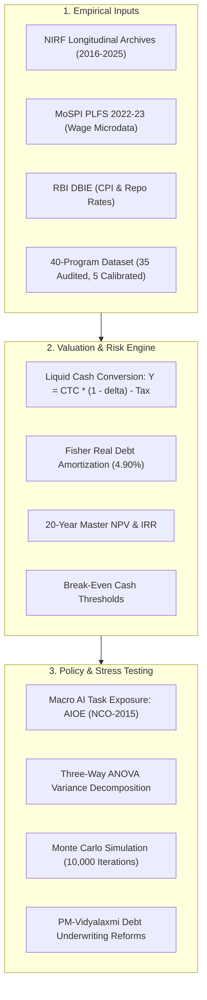
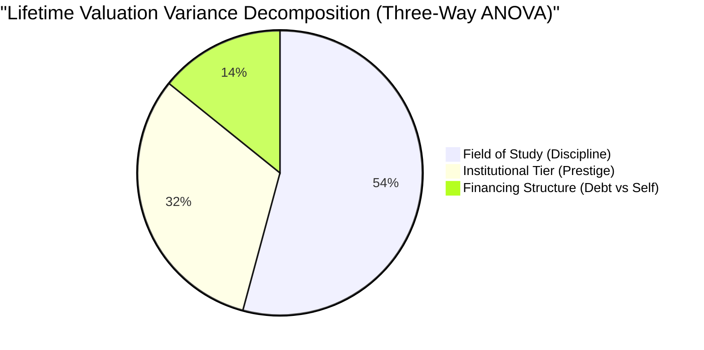

# A Risk-Adjusted Framework for Valuing Higher Education in India
### Estimating Heterogeneous Returns to Undergraduate Education Under Cost, Financing, and Labor-Market Uncertainty

[](https://www.python.org/downloads/)
[](https://creativecommons.org/licenses/by/4.0/)
[](full_report.py)
[](complete_revised_manuscript_zenodo.md)

---

## Authorship & Scholarly Supervision

- **Author:** **Bhavmanyu Singh Sisodia** (Correspondence: `bhavmanyu25@gmail.com`)
- **Supervising Faculty:** **Dr. Jaikishan Sahu** &bull; Professor, RPL Maheshwari College, Indore, India

---

## Executive Summary & Abstract

Every year, millions of Indian families make the largest financial bet of their lives: paying for an undergraduate degree with almost no reliable information beyond an ordinal college ranking and a headline salary figure. This research project constructs a capital-budgeting valuation framework that treats a college degree the way an investor treats any major capital asset—as a series of uncertain future cash flows weighed against upfront costs, financing terms, and labor-market risks.

Using a ten-year longitudinal panel from the **National Institutional Ranking Framework (NIRF, 2016–2025)**, official employment benchmarks from the **Periodic Labour Force Survey (MoSPI PLFS 2022–23)**, **Reserve Bank of India (RBI)** monetary series, and audited placement disclosures across **40 undergraduate degree programs**, we establish four robust empirical patterns:



### Core Empirical Findings

1. **NIRF Perception Formula Artifact:** Regressions of published composite scores on objective indicators (faculty, research, graduation outcomes, and diversity) account for 90.5% to 99.1% of composite score variance. The subjective "Perception" metric functions as an accounting artifact of the statutory formula (formula partial $R^2 = 0.4286$ overall; $0.9999$ in single-formula categories), introducing substantial ordinal rank volatility (averaging 22 positions among ranks 50–200) without yielding independent pedagogical or labor-market signal.
2. **CTC vs. In-Hand Pay & The 84.7% Early-Career Debt Squeeze:** Advertised Cost-to-Company (CTC) figures significantly overstate disposable cash. After deducting non-cash benefits, mandatory contributions, New Tax Regime liabilities (Section 115BAC), and commercial debt service (10.15% nominal; 4.90% Fisher real rate), graduates from high-fee private colleges face initial debt-service-to-income (DSTI) burdens consuming up to **84.7% of early-career monthly take-home pay**, creating acute short-term default risk.
3. **Discipline Dominates Prestige (54.2% vs. 31.6%):** In a three-way Analysis of Variance (ANOVA), field of study accounts for **54.2%** of lifetime valuation variance, compared to **31.6%** for institutional tier and **14.2%** for financing structure. Switching from basic sciences to computer science at a regional public college adds **INR 22.9 Lakhs** to lifetime NPV—nearly double the gain of upgrading from an NIT to an IIT within computer science (**INR 12.8 Lakhs**).
4. **Task-Based AI Disruption:** Linking US SOC-2018 task exposure to the Indian National Classification of Occupations (NCO-2015) reveals an asymmetric risk gradient. Routine software syntax and basic accounting face substantial downward valuation pressure, while clinical medicine and hands-on civil engineering maintain structural downside resilience.



---

## Repository Structure

```
├── A_Risk_Adjusted_Framework_for_Valuing_Higher_Education_in_India_Revised.pdf  # Compiled 26-page Working Paper (PDF)
├── research project final.pdf                                                  # Direct print copy of manuscript
├── research project final.html                                                 # Interactive publication HTML
├── complete_revised_manuscript_zenodo.md                                     # Full Zenodo Working Paper Markdown
├── build_paper_html.py                                                         # Master compiler (HTML + Headless Edge PDF)
│
├── run_monte_carlo.py                                                          # 10,000-iteration Monte Carlo Simulation
├── test_tornado.py                                                             # Tornado Sensitivity Analysis Engine
├── check_reproducibility.py                                                    # Mathematical verification & solver checks
│
├── full_report.py                                                              # 49-point cross-check validation suite
├── validate_final.py                                                           # Structural & numerical integrity auditor
│
├── extracted_refs.txt                                                          # 58 verified bibliographic references
└── README.md                                                                   # Project documentation & replication codebook
```

---

## Replication & Quick Start

### 1. Prerequisites
Ensure Python 3.10 or higher is installed with standard scientific computing packages:
```bash
pip install numpy matplotlib reportlab pypdfium2
```

### 2. Run the Monte Carlo Risk Simulation (10,000 Iterations)
Simulates lifetime NPV distributions, downside confidence intervals, and negative-NPV probabilities across representative student profiles:
```bash
python run_monte_carlo.py
```

### 3. Run the Tornado Parameter Swing Analysis
Evaluates the relative sensitivity of degree valuation to discount rates, real wage growth, starting cash haircuts, and AI drag:
```bash
python test_tornado.py
```

### 4. Verify Reproducibility & Mathematical Benchmarks
Verifies the Fisher equation debt deflator, New Tax Regime brackets, and break-even salary solvers:
```bash
python check_reproducibility.py
```

### 5. Execute the Automated Validation Test Suite
Runs the 49-point cross-check auditor verifying all equations (1–11), 10 figures, 13 tables, and 58 academic references:
```bash
python full_report.py
python validate_final.py
```

### 6. Recompile the Complete Manuscript PDF
Generates the camera-ready HTML and compiles the 26-page PDF using Microsoft Edge headless:
```bash
python build_paper_html.py
```

---

## Master Net Present Value (NPV) Formulation

The lifecycle valuation engine evaluates prospective degrees over a $T = 20$-year post-graduation horizon:

$$\text{NPV}_p = -(C_p - L_p) - \text{OC}_p \cdot d_p + \sum_{t=1}^{T} \frac{\pi_p \cdot \mathbb{E}[Y_{p,t}] - D_{p,t}}{(1 + r)^t} \tag{3}$$

where:
- $C_p$: Direct cumulative tuition, institutional levies, and living costs over program duration $d_p$.
- $L_p$: Principal borrowed through commercial education debt ($L_p \in [0, C_p]$).
- $\text{OC}_p \cdot d_p$: Compounding opportunity cost of forgone earnings benchmarked to the PLFS 2022–23 secondary-educated youth wage (₹14,000/month or ₹1.68 Lakhs/year).
- $\pi_p$: Institutional placement probability at graduation.
- $\mathbb{E}[Y_{p,t}]$: Expected real post-tax in-hand cash salary in career year $t$.
- $D_{p,t}$: Annual real debt service deflated via the Fisher equation at $r_{\text{loan}}^{\text{real}} = 4.9048\%$ ($10.15\%$ nominal loan rate, $5.00\%$ CPI inflation).
- $r$: Subjective household real opportunity cost of capital ($r_{\text{base}} = 8.0\%$).

---

## Data Availability & Open Science Statement

All empirical inputs, institutional disclosures, and simulation parameters are fully documented within the manuscript:
1. **NIRF Historical Data:** Publicly archived annual tables across 9 categories (2016–2025) from the Ministry of Education (`nirfindia.org`).
2. **PLFS Microdata:** Ministry of Statistics and Programme Implementation (MoSPI) Periodic Labour Force Survey 2022–23 Unit-Level Wage Tables.
3. **Macro-Financial Data:** Reserve Bank of India Database on Indian Economy (DBIE) policy repo rates and CPI series.
4. **40-Program Dataset:** Program-level fee, placement, and salary disclosures across 35 audited institutional disclosures and 5 calibrated reference archetypes (Technical Appendix C).

---

## Citation & Academic Attribution

If you use this valuation model, econometric specifications, or dataset in your research, please cite:

```bibtex
@article{sisodia2026riskadjusted,
  title={A Risk-Adjusted Framework for Valuing Higher Education in India: Estimating Heterogeneous Returns to Undergraduate Education Under Cost, Financing, and Labor-Market Uncertainty},
  author={Sisodia, Bhavmanyu Singh},
  note={Supervised by Dr. Jaikishan Sahu, Professor, RPL Maheshwari College, Indore, India},
  journal={Zenodo Working Paper},
  publisher={Zenodo},
  year={2026},
  month={November},
  keywords={Higher education valuation, Net Present Value, NIRF, PLFS, AI task exposure, India}
}
```

---

## License

This repository and manuscript are licensed under the [Creative Commons Attribution 4.0 International License (CC BY 4.0)](https://creativecommons.org/licenses/by/4.0/). Code routines and simulation solvers are additionally provided under the [MIT License](LICENSE).
